# מודל הנתונים

המסמך מתאר את כל הטבלאות במסד הנתונים (Postgres ב־Supabase), את הקשרים ביניהן ואת חוקי ההרשאות.
הוא נגזר מ־`docs/product-spec.md`. כל שינוי כאן יהפוך בהמשך לקובץ migration.

**מוסכמות**:
- שמות טבלאות ועמודות באנגלית, ברבים ובאותיות קטנות עם קו תחתון (`wine_vintages`).
- **מפתח ראשי** `id` מסוג `uuid` בכל טבלה (חוץ מטבלאות קישור).
- `created_at` / `updated_at` בכל טבלה שמשתנה.
- **ערכים מוגדרים מראש** נשמרים כ־`enum` של Postgres, כך שהמסד עצמו דוחה ערך לא חוקי.

---

## תרשים (ERD)

GitHub מציג את התרשים הזה כציור. כל קו הוא קשר: `||--o{` פירושו "אחד לרבים".

```mermaid
erDiagram
    profiles ||--|| cellar_members : "חבר ב"
    cellars ||--o{ cellar_members : "חברים"
    cellars ||--o{ cellar_invites : "הזמנות"
    cellars ||--o{ friend_links : "חברים של"
    cellars ||--o{ friend_invites : "הזמנות חברות"
    cellars ||--o{ share_links : "קישורי צפייה"

    cellars ||--o{ fridges : "מקררים"
    fridge_models ||--o{ fridges : "תבנית"
    fridges ||--o{ shelves : "מדפים"
    shelves ||--o{ shelf_zones : "אזורים"

    cellars ||--o{ wines : "יינות"
    wines ||--o{ wine_vintages : "בצירים"
    wine_vintages ||--o{ critic_scores : "ציוני מבקרים"
    wine_vintages ||--o{ bottles : "בקבוקים"
    shelf_zones ||--o{ bottles : "מיקום"
    bottles ||--o| bottle_prices : "מחיר"

    wines ||--o{ ratings : "ציונים"
    wines ||--o{ tastings : "אירועי שתייה"
    bottles ||--o| tastings : "נשתה ב"
    wines ||--o{ wishlist_items : "משאלות"
    cellars ||--o{ drafts : "טיוטות"

    profiles {
        uuid id PK "זהה ל־auth.users"
        text display_name
        text locale "he / en"
        text theme "light / dark / system"
        timestamptz onboarded_at "NULL = עוד לא עבר הדרכה"
    }
    cellars {
        uuid id PK
        text name
        bool name_is_custom
    }
    cellar_members {
        uuid cellar_id FK
        uuid user_id FK "UNIQUE – מרתף אחד למשתמש"
        enum role "member / viewer"
    }
    fridges {
        uuid id PK
        uuid cellar_id FK
        uuid model_id FK "אופציונלי"
        text name
        int position
    }
    shelf_zones {
        uuid id PK
        uuid shelf_id FK
        int position
        enum kind "row / stack"
        int capacity
        text label "קדמית, אחורית..."
    }
    wines {
        uuid id PK
        uuid cellar_id FK
        text winery
        text name
        enum type
        text grape
        text country
        text region
        enum kosher
        enum shape
        text label_image_path
    }
    wine_vintages {
        uuid id PK
        uuid wine_id FK
        int year "NULL = ללא בציר (NV)"
        int drink_from
        int drink_to
        int peak_from
        int peak_to
        enum window_source
        numeric alcohol
    }
    bottles {
        uuid id PK
        uuid cellar_id FK
        uuid vintage_id FK
        enum status
        uuid zone_id FK "NULL אם לא במקרר"
        int slot "NULL בערימה"
        text link_url
        text note
        date added_on
        date consumed_on
    }
    bottle_prices {
        uuid bottle_id PK
        numeric paid
        numeric regular
        bool is_gift
    }
    ratings {
        uuid id PK
        uuid wine_id FK
        uuid vintage_id FK "NULL = לכל הבצירים"
        uuid rater_id FK "NULL = ציון משותף"
        numeric score "1.0–5.0"
    }
    tastings {
        uuid id PK
        uuid wine_id FK
        uuid vintage_id FK "אופציונלי"
        uuid bottle_id FK "NULL = מחוץ למרתף"
        date tasted_on
        text place
        text notes
    }
    drafts {
        uuid id PK
        uuid cellar_id FK
        enum kind
        jsonb payload
        enum status
        enum source "mcp / paste"
    }
```

---

## הטבלאות לפי נושא

### 1. משתמשים ומשק בית
| טבלה | תפקיד | פרטים חשובים |
|---|---|---|
| `profiles` | פרטי משתמש שאינם התחברות | ה־`id` זהה למשתמש בטבלת ההתחברות של Supabase (`auth.users`). אנחנו לא נוגעים בסיסמאות או במיילים – Supabase מנהל אותם. |
| `cellars` | המרתף | השם נוצר אוטומטית משמות החברים, אלא אם `name_is_custom`. |
| `cellar_members` | מי שייך לאיזה מרתף ובאיזה תפקיד | **אילוץ ייחודיות על `user_id`** – זה מה שאוכף "מרתף אחד למשתמש". |
| `cellar_invites` | קישורי הזמנה למשק הבית | שומרים **גיבוב (hash) של הטוקן**, לא את הטוקן עצמו – אותו עיקרון כמו בסיסמאות. `expires_at` (7 ימים), `used_at` (חד־פעמי). |

### 2. חברים ושיתוף
| טבלה | תפקיד | פרטים חשובים |
|---|---|---|
| `friend_links` | חברות בין מרתפים | **שתי שורות לכל חברות**, אחת לכל כיוון: `(owner_cellar_id, friend_cellar_id, shows_prices)`. ככה לכל צד יש מתג מחירים משלו, והשאלה "האם מותר לי לראות את המחירים של מאיה" היא חיפוש של שורה אחת. |
| `friend_invites` | קישורי הזמנה לחברות | כמו `cellar_invites`, ובנוסף `shows_prices` – הבחירה של השולח. |
| `share_links` | קישור צפייה בלי חשבון | `hide_prices`, `revoked_at`. (`hide_history` הוסר במיגרציה 27: ההיסטוריה לא משותפת בקישור בכלל.) **אינדקס ייחודי חלקי** מבטיח קישור פעיל אחד לכל מרתף. |

### 3. מקררים
| טבלה | תפקיד | פרטים חשובים |
|---|---|---|
| `fridge_models` | קטלוג דגמים (יצרן, דגם, סידור) | הסידור נשמר כ־JSON, כי הוא רק **תבנית** להעתקה. גלוי לכולם. |
| `fridges` | מקרר של מרתף | `model_id` אופציונלי – זוכרים מאיזו תבנית נוצר, אבל לא תלויים בה. |
| `shelves` | מדף | `position` קובע את הסדר מלמעלה למטה. |
| `shelf_zones` | אזור במדף | `kind`: שורה (`row`, מקומות ממוספרים) או ערימה (`stack`, רק קיבולת). **ערימה בגובה שני בקבוקים = שני אזורי ערימה** ("שכבה עליונה", "שכבה תחתונה"). מגירה עם שורה אחורית וקדמית = שני אזורי שורה. כך כל סידור נבנה מאותן שתי אבני בניין, בלי עמודות מיוחדות. |

**למה טבלאות ולא JSON לסידור של מקרר אמיתי?** כי בקבוקים מפנים לאזור (`bottles.zone_id`). מפתח זר (foreign key) מבטיח שבקבוק לא יפנה לאזור שלא קיים – את זה JSON לא יודע לאכוף. בתבנית בקטלוג אין בקבוקים, ולכן שם JSON מספיק.

### 4. יינות ובקבוקים
| טבלה | תפקיד | פרטים חשובים |
|---|---|---|
| `wines` | יין: יקב ושם | **ייחודי לכל מרתף** לפי יקב ושם (בלי הבדל באותיות גדולות/קטנות). |
| `wine_vintages` | יין בשנה מסוימת | `year` ריק = יין ללא בציר (NV, נפוץ במבעבעים). חלון השתייה ושנות השיא כאן. |
| `critic_scores` | ציוני מבקרים | מבקר וציון 50–100. הממוצע המעוגל **מחושב**, לא נשמר. |
| `bottles` | בקבוק פיזי | ראה "מצב בקבוק" למטה. |
| `bottle_prices` | המחיר של בקבוק | **טבלה נפרדת** – ראה ADR 0003. |

**מצב בקבוק** (`status`):

| ערך | משמעות | מיקום |
|---|---|---|
| `stored` | במקרר | `zone_id` חובה; `slot` חובה בשורה, ריק בערימה |
| `unplaced` | מחוץ למקרר | ריק |
| `in_transit` | בדרך | ריק |
| `consumed` | נשתה | ריק. המיקום האחרון נשמר באירוע השתייה |

**אילוצים שהמסד אוכף בעצמו**:
- `CHECK`: בקבוק במצב `stored` חייב `zone_id`, ובכל מצב אחר `zone_id` ריק.
- **ייחודיות** על `(zone_id, slot)` – שני בקבוקים לא יכולים לשבת באותו מקום. זה הפתרון ל־race condition.
- **קיבולת ערימה** נבדקת בפונקציה בשרת (אילוץ ייחודיות לא יודע לספור).

### 5. ציונים, שתייה ומשאלות
| טבלה | תפקיד | פרטים חשובים |
|---|---|---|
| `ratings` | ציון ליין או לבציר | `vintage_id` ריק = לכל הבצירים. `rater_id` ריק = ציון משותף. ייחודי על `(wine_id, vintage_id, rater_id)`. |
| `tastings` | אירוע שתייה | `bottle_id` ריק = שתייה מחוץ למרתף. `notes` – הערת טעימה אחת לאירוע. |
| `wishlist_items` | פריט ברשימת משאלות | מצביע על `wines`. יין מחבר **מועתק** לטבלת היינות של המרתף שלי, בלי בקבוקים. **המקרר והרשימה מציגים בקבוקים, לא יינות**, ולכן יין בלי בקבוקים לא מופיע בהם. `year` אופציונלי, `note`, `link_url`, `source_note` ("ראיתי אצל מאיה"). |
| `drafts` | טיוטות מ־AI | `payload` ב־JSON, כי לכל סוג טיוטה מבנה אחר. הוולידציה קורית ברגע האישור, באותה שכבת שירותים של הממשק. |

**מה מחושב ולא נשמר** (כי הוא נגזר מנתונים אחרים ומשתנה מעצמו):
- מצב הבשלות וצבע הבציר – לפי השנה הנוכחית.
- ממוצע ציוני המבקרים.
- הציון שמוצג (בציר, ואם אין – יין).
- סטטיסטיקות וסיכום שנה – מ־`added_on`, `consumed_on` והמחירים.

---

## הרשאות (Row Level Security)

**השחקנים**:
- **חבר** – `role = member` במרתף.
- **צופה** – `role = viewer` במרתף.
- **חבר־מרתף** – מרתף שיש לו `friend_links` אל המרתף.
- **אורח** – מי שמחזיק קישור צפייה, בלי חשבון.

| נתונים | חבר | צופה | חבר־מרתף | אורח (קישור) |
|---|---|---|---|---|
| מקררים, מדפים, אזורים | קריאה + כתיבה | קריאה | קריאה | קריאה |
| יינות, בצירים, בקבוקים | קריאה + כתיבה | קריאה | קריאה | קריאה |
| **מחירים** (`bottle_prices`) | קריאה + כתיבה | קריאה | **רק אם `shows_prices`** | רק אם לא `hide_prices` |
| ציונים | קריאה + כתיבה | קריאה | קריאה | קריאה |
| היסטוריה (`tastings`, בקבוקים שנשתו) | קריאה + כתיבה | קריאה | קריאה | לא (מיגרציה 27) |
| רשימת משאלות | קריאה + כתיבה | קריאה | קריאה | – |
| שמות (`profiles.display_name`) של מי שבמרתף | קריאה | קריאה | קריאה | – |
| חברי משק הבית, הזמנות, קישורים | קריאה + כתיבה | קריאה | – | – |
| טיוטות | קריאה + כתיבה | – | – | – |

**איך זה ממומש**:
- **פונקציות עזר** במסד הנתונים, למשל `is_member(cellar_id)` ו־`can_view(cellar_id)`. כל חוק RLS קורא להן, כך שהלוגיקה כתובה פעם אחת.
- **האורח** לא מחובר, ולכן RLS לא יודע מי הוא. הגישה שלו עוברת דרך **פונקציה אחת בשרת** שמקבלת את הטוקן, בודקת אותו, ומחזירה רק את מה שמותר. מחוץ לפונקציה הזו לאורח אין גישה לשום טבלה.
- **סנכרון בזמן אמת** של Supabase מכבד את חוקי ה־RLS: משתמש מקבל עדכונים רק על שורות שמותר לו לראות.
- **פעולות מורכבות** (הצטרפות למרתף, אישור חברות, אישור טיוטה, "שתינו") ממומשות כפונקציות שרצות **בטרנזקציה אחת** – או שהכול מצליח, או ששום דבר לא משתנה.

---

## החלטות שנרשמו כ־ADR
- `0002` – יין ← בציר ← בקבוק.
- `0003` – מחירים בטבלה נפרדת בגלל RLS.
- `0004` – מרתף אחד למשתמש, דרך טבלת חברות.
